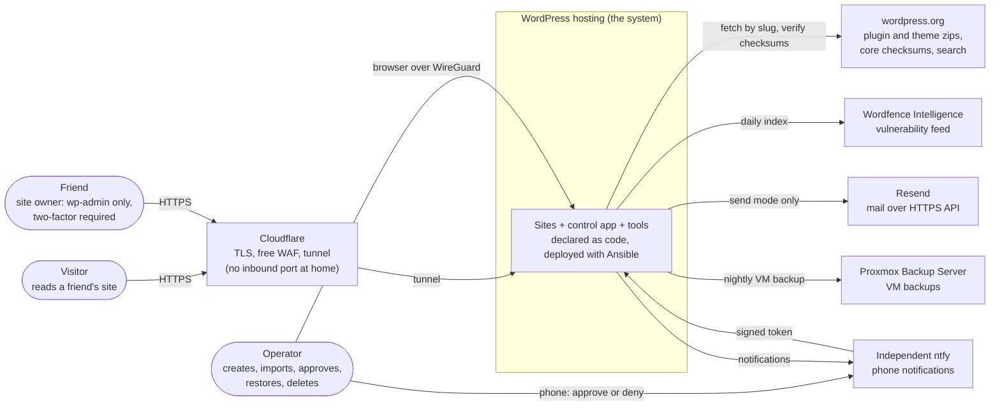
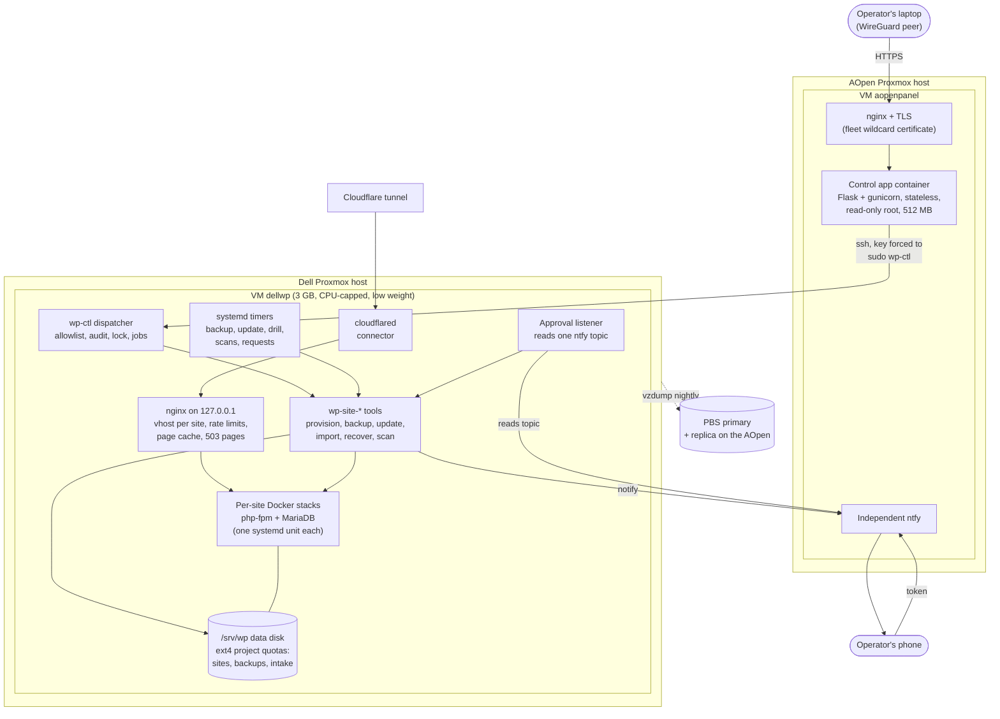
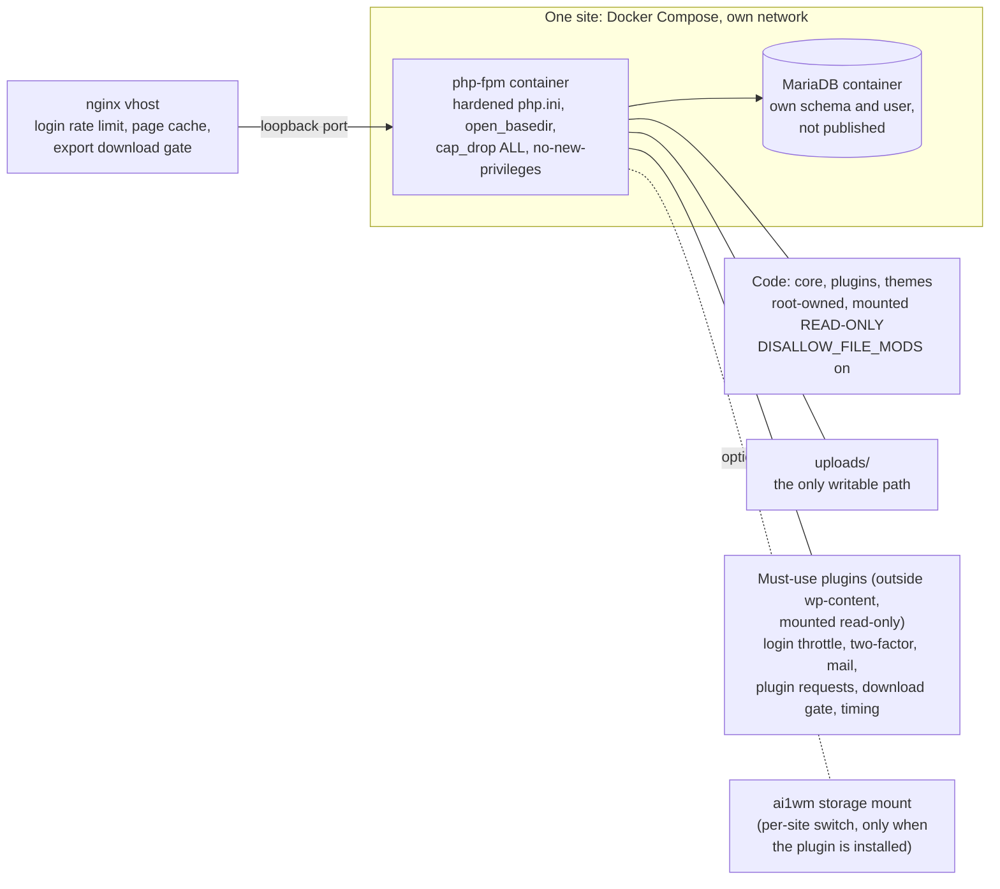
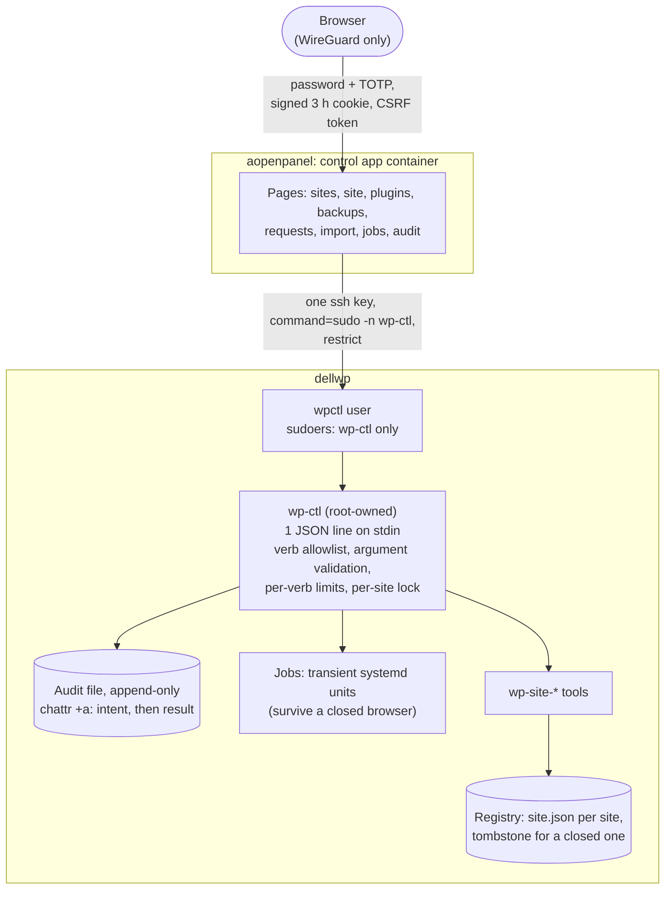
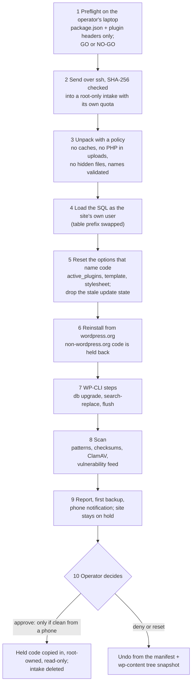
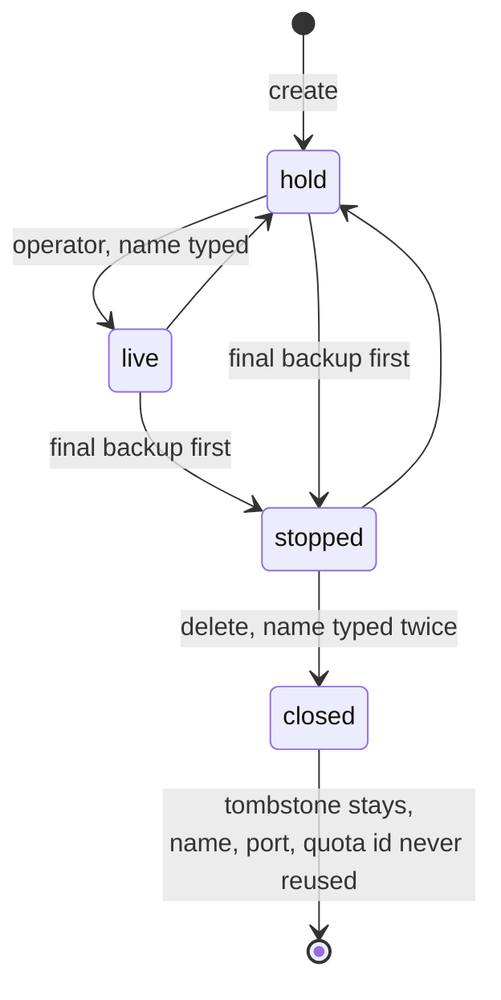
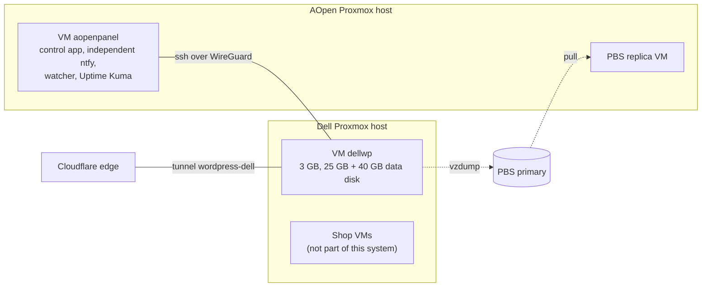

# Architecture (C4 views)

Four levels of the [C4 model](https://c4model.com/) plus the import flow, drawn as plain Mermaid flowcharts (GitHub renders them; Mermaid's own `C4` syntax is still marked experimental, so it is not used here). Everything is as of the last state of the service, 2026-11-15. The reasoning behind each choice is in [`wordpress_hosting.md`](wordpress_hosting.md); the one-line decisions are in [`decisions.md`](decisions.md).

Names: `dellwp` is the VM that runs the sites, `aopenpanel` is the VM that runs the control app, the "operator" is the one person who runs everything, a "friend" is the owner of a site.

## Level 1: system context

Who uses the system and which outside services it depends on.

## Level 2: containers (what runs where)

Two VMs on two Proxmox hosts. The sites never share a VM with the shop, and the control app never runs on the VM it controls.

## Level 3a: components of a site stack

What one friend's site is made of, and which parts PHP may write to.

## Level 3b: components of the control chain

Why a compromised control app can do only what the allowlist says.

## Level 3c: the import pipeline

A friend's `.wpress` file is untrusted input: the database names code that WordPress will `include`. The pipeline, in order (details in section 5.6 of the main document).

## Site states

## Deployment view

